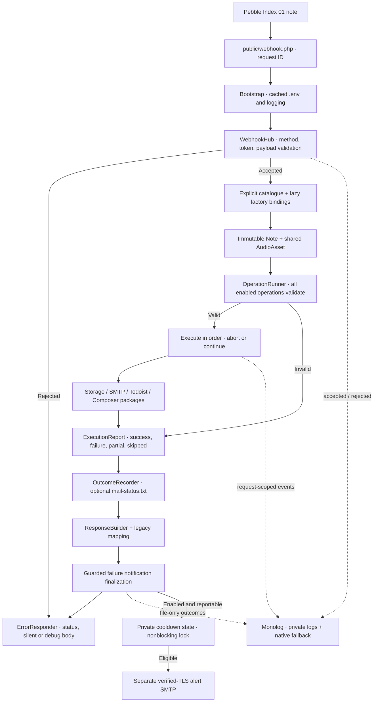

# Hub architecture

The public entry point captures an HTTP request, generates an internal request ID,
loads the hub, and sends its response. Core orchestration is destination-independent.

The hub creates a note only when at least one operation is enabled. Complete
preflight occurs before destination writes. Internal failures take precedence over
upstream failures, then validation errors (500, 502, 400). Successful/partial work
is retained when later delivery fails; there is no automatic replay or rollback.

Audio is shared by reference with explicit ownership. Services copy data for their
own destination and leave the input readable. The hub releases only its own temporary
assets in finally; PHP upload and durable-storage lifecycles remain separate. No
retained audio is attached to operator alerts.

Configuration responsibilities:

- `config/operations.php`: explicit IDs, environment switches, factory IDs/classes,
  order, and failure policy.
- `config/operation-factories.php`: lazy constructors for additional packages,
  receiving the cached environment; disabled package classes need not be installed.
- `src/Config/`: typed destination and infrastructure settings. Built-in factory
  IDs/switches cannot be replaced by extension bindings.
- `src/Operation/`: common contracts, runner, reports, and outcome recording.
- `src/Logging/` and `src/Notification/`: infrastructure; logging and alert failure
  cannot change destination results or the intended HTTP status.

File logging and failure email are independently optional. Debug mode suppresses
both unless their own debug opt-in is enabled. Notification eligibility is based
on the operation/configuration report, not subscribing to every logger error.
Notification outcomes therefore cannot recursively email an operator.

See [operations](OPERATIONS.md), [extensions](EXTENSIONS.md), [logging](LOGGING.md),
and [notifications](NOTIFICATIONS.md) for contracts and limitations.
